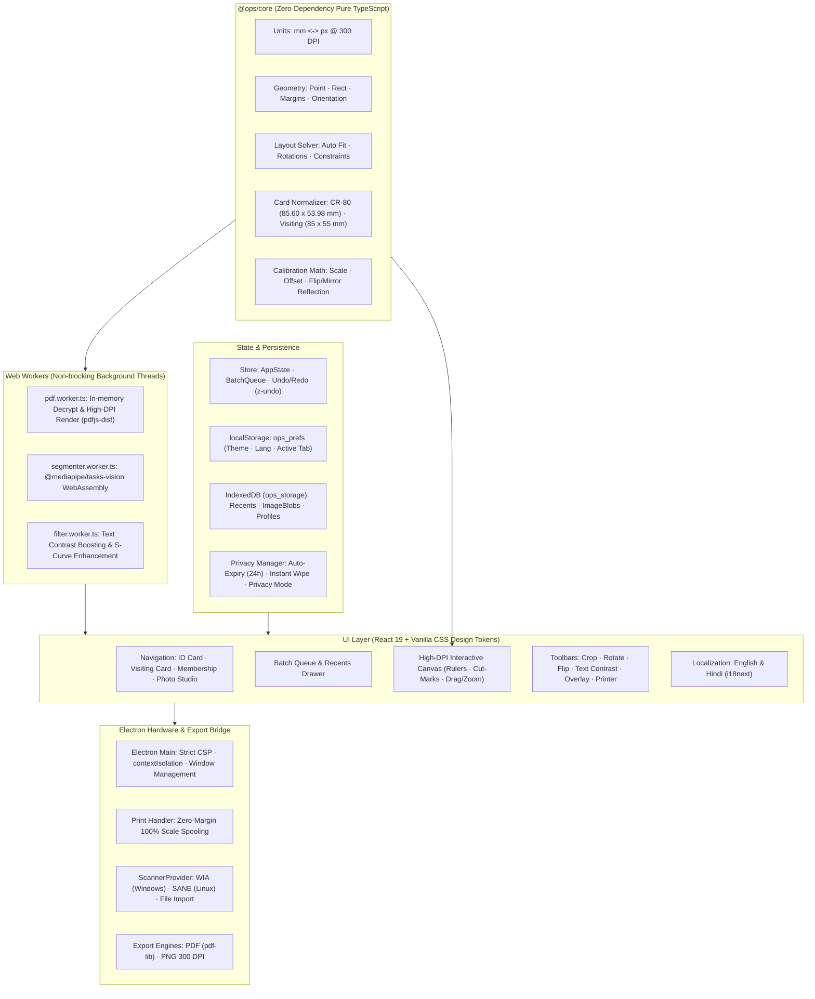
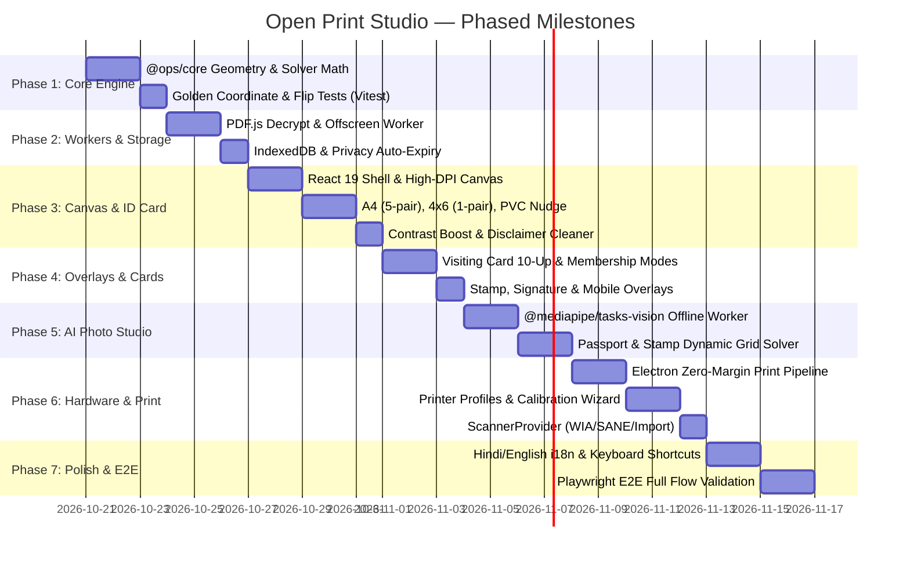

# Open Print Studio — Implementation Plan
## Technical Architecture, Folder Structure, Milestones & Test Plan

**Document Version:** 1.0.0  
**Target Platform:** Desktop (Electron + React 19 + TypeScript + Vite)  
**Author:** Senior Product Architect & Full-Stack Engineer  
**Status:** Pending Stakeholder Approval (Phase 0 Review)  

---

> [!IMPORTANT]
> This plan details the phased execution strategy for **Open Print Studio** (`OPS`), designed for busy retail operators in Indian Cyber Cafes, CSCs, and Photo Studios. It guarantees offline-first privacy, mathematical precision at 300 DPI, zero UI freezing, and strict clean-room separation.

---

## 1. System Architecture

Open Print Studio is structured with clean physical separation between pure mathematical modeling, worker offloading, UI rendering, and the native hardware bridge:



---

## 2. Architectural Principles & Key Subsystems

### 2.1 Pure TypeScript Core (`@ops/core`)
- **Zero-Dependency Guarantee:** Absolute ban on DOM (`window`, `document`), React, or Electron imports.
- **Deterministic Math:**
  - Standard DPI constant: $300\,\text{DPI} \implies 1\,\text{mm} = \frac{300}{25.4} \approx 11.8110236\,\text{px}$.
  - Golden precision: Floating-point millimeter operations rounded to 4 decimal places with exact integer pixel snapping for rasterization.
  - Flip/Mirror Math: Matrix reflection $(x', y') = (W - x - w, y)$ guarantees that mirrored output is **pixel-for-pixel identical** when inverted.
- **Testability:** 100% covered by Vitest unit tests, runnable in pure Node.js environments in milliseconds.

### 2.2 Asynchronous Worker Pipeline
- **PDF Engine (`pdf.worker.ts`):** Decrypts password-protected PDFs (e.g. UIDAI format) in memory. Renders target page onto an `OffscreenCanvas` at 300 DPI, returning a transferrable `ImageBitmap` to the main thread.
- **AI Segmenter Worker (`segmenter.worker.ts`):** Initializes `@mediapipe/tasks-vision` `ImageSegmenter` with offline-bundled `.tflite` model and WASM binaries. Processes portraits in $< 600\,\text{ms}$, returning a refined alpha confidence mask.
- **Main Thread Unblocked:** Heavy canvas rendering, filter matrix transformations, and decoding never cause UI frame drops.

### 2.3 Typed Settings & Versioned Migration Schema
- All configuration follows a versioned schema (`version: 1`):
  ```typescript
  export interface OPSAppSettingsV1 {
    schemaVersion: 1;
    theme: "dark" | "light";
    locale: "en" | "hi";
    privacyMode: boolean;
    autoExpiryDays: number; // default: 1 (24 hours)
    defaultPrinterProfileId?: string;
    showCutGuides: boolean;
    showRulers: boolean;
  }
  ```
- **Migration Pipeline:** A deterministic migration function `migrateSettings(raw: unknown): OPSAppSettings` validates types and safely migrates older schemas forward without data loss.
- **Import/Export:** Shopkeepers can export their calibrated printer profiles to a `.ops-profile` JSON file to share across computers in the same shop.

### 2.4 Print & Export Pipeline
- **Zero-Margin Print Spooling:** Electron's `webContents.print` is triggered with:
  ```typescript
  {
    silent: false,
    printBackground: true,
    margins: { marginType: "none" },
    pageSize: profile.pageSize,
    landscape: profile.orientation === "landscape",
    scaleFactor: 100
  }
  ```
- **Vector PDF Export (`pdf-lib`):** Generates archival-grade PDF documents with 300 DPI embedded PNG cards and vector crop marks, ensuring identical output across any PDF viewer.
- **High-Res PNG Export:** Generates uncompressed 300 DPI PNGs for shops sending jobs to external lab printers.

### 2.5 Printer Calibration Wizard
1. The operator prints a standardized **Test Calibration Sheet** containing precision $100\,\text{mm}$ reference rulers on the $X$ and $Y$ axes and card boundary targets.
2. The operator measures the printed line lengths using a physical metric ruler and enters the actual measured lengths (e.g., $99.4\,\text{mm}$ measured for $100.0\,\text{mm}$ target).
3. The app computes:
   $$\text{scaleX} = \frac{100.0}{\text{measuredX}},\quad \text{scaleY} = \frac{100.0}{\text{measuredY}}$$
   $$\text{offsetX} = \text{targetOriginX} - \text{measuredOriginX},\quad \text{offsetY} = \text{targetOriginY} - \text{measuredOriginY}$$
4. Calibration values are saved under a named **Printer Profile** in IndexedDB.

---

## 3. Detailed Folder & Code Structure

```
open-print-studio/
├── docs/
│   ├── PRD_REVIEW.md                 # Full technical audit & mathematical proofs
│   ├── IMPLEMENTATION_PLAN.md        # This document
│   ├── DECISIONS.md                  # Architectural Decision Records (ADRs)
│   └── PRD_v3.md                     # Clean-room PRD v3 specification
├── packages/
│   └── core/                         # Pure TypeScript core logic
│       ├── package.json
│       ├── tsconfig.json
│       └── src/
│           ├── index.ts              # Public API barrel
│           ├── constants/
│           │   ├── dimensions.ts     # ISO ID-1, Paper Sizes, Tolerances
│           │   └── dpi.ts            # 300 DPI conversion constants & rounding
│           ├── geometry/
│           │   ├── point.ts          # 2D Point primitives
│           │   ├── rect.ts           # Bounding boxes, intersections, clamping
│           │   └── transform.ts      # Scale, rotate, flip/mirror matrices
│           ├── layout/
│           │   ├── layout-solver.ts  # Generic row/col solver with rotation
│           │   ├── id-card-layouts.ts# A4 (5-pair), 4x6 (1-pair), PVC Tray
│           │   ├── visiting-layouts.ts # 10-up A4 visiting card solver
│           │   └── photo-layouts.ts  # Passport & Stamp grid solver
│           ├── crop/
│           │   ├── normalizer.ts     # Card normalization to CR-80 pixels
│           │   └── auto-crop-coords.ts # Coordinate maps (Aadhaar, Ayushman, PAN)
│           ├── calibration/
│           │   └── calibration-math.ts # Ruler measurement scale/offset solver
│           └── filters/
│               └── s-curve.ts        # Analytical text contrast darkening
├── src/                              # Desktop App Frontend
│   ├── index.html                    # Entry point with strict CSP
│   ├── main.tsx                      # React 19 root
│   ├── App.tsx                       # Root layout & navigation shell
│   ├── index.css                     # Custom design tokens, glassmorphism, dark/light
│   ├── assets/                       # Local icons, test patterns
│   ├── workers/
│   │   ├── pdf.worker.ts             # PDF.js decryption & offscreen rasterizer
│   │   ├── segmenter.worker.ts       # MediaPipe tasks-vision AI background remover
│   │   └── filter.worker.ts          # Offscreen canvas pixel contrast filter
│   ├── services/
│   │   ├── storage/
│   │   │   ├── indexed-db.ts         # Dexie / raw IDB for recent designs & blobs
│   │   │   ├── prefs-storage.ts      # localStorage for lightweight preferences
│   │   │   └── privacy-manager.ts    # Auto-expiry, wipe, and privacy mode
│   │   ├── scanner/
│   │   │   ├── scanner-provider.ts   # Interface definition
│   │   │   ├── wia-provider.ts       # Windows WIA bridge
│   │   │   ├── sane-provider.ts      # Linux SANE bridge
│   │   │   └── file-import-provider.ts # Fallback file importer
│   │   ├── print/
│   │   │   ├── print-service.ts      # Native Electron print caller
│   │   │   └── pdf-export-service.ts # pdf-lib vector + 300 DPI PDF exporter
│   │   └── i18n/
│   │       ├── i18n.ts               # Localization setup
│   │       ├── locales/en.json       # English translations
│   │       └── locales/hi.json       # Hindi translations
│   ├── store/
│   │   ├── app-store.ts              # Zustand active tab, UI state
│   │   ├── batch-store.ts            # Batch queue documents
│   │   ├── calibration-store.ts      # Saved printer profiles
│   │   └── history-middleware.ts     # Undo/Redo state stack
│   ├── components/
│   │   ├── layout/
│   │   │   ├── Header.tsx            # App bar, theme toggle, privacy indicator, lang
│   │   │   ├── NavTabs.tsx           # ID Card / Visiting / Membership / Photo
│   │   │   └── RecentsDrawer.tsx     # Session restore sidebar with clear all
│   │   ├── canvas/
│   │   │   ├── CanvasWorkspace.tsx   # Interactive canvas with pan, zoom, rulers
│   │   │   ├── Rulers.tsx            # Precision millimeter rulers
│   │   │   ├── CutMarks.tsx          # Vector cut guide overlays
│   │   │   └── CropOverlay.tsx       # Dual-crop handles with ratio locking
│   │   ├── modules/
│   │   │   ├── id-card/              # ID & Membership card workspace
│   │   │   ├── visiting-card/        # Visiting card 10-up workspace
│   │   │   └── photo-studio/         # AI Portrait segmentation workspace
│   │   ├── dialogs/
│   │   │   ├── PasswordDialog.tsx    # PDF password prompt with hint
│   │   │   ├── CalibrationWizard.tsx # Interactive printer calibration
│   │   │   ├── DriverGuideModal.tsx  # In-app driver tray setup guide
│   │   │   └── SettingsModal.tsx     # Settings, privacy controls, export/import
│   │   └── common/
│   │       ├── Button.tsx            # Large touch-friendly Cyber Cafe buttons
│   │       ├── Slider.tsx            # Nudge & contrast sliders
│   │       └── Toast.tsx             # Friendly error notices
├── electron/                         # Electron Main & Preload
│   ├── main.ts                       # App lifecycle, window, strict CSP
│   ├── preload.ts                    # Context-isolated safe IPC bridges
│   └── ipc/
│       ├── print-ipc.ts              # Native print commands
│       ├── scanner-ipc.ts            # WIA/SANE hardware calls
│       └── file-ipc.ts               # Native file dialogs & temp cleanup
├── tests/
│   ├── unit/                         # Vitest Core Tests
│   │   ├── units.test.ts             # mm <-> px @ 300 DPI
│   │   ├── layout-solver.test.ts     # Solver constraints & capacities
│   │   ├── golden-layouts.test.ts    # Exact mm coordinates for A4, 4x6, PVC
│   │   ├── flip-mode.test.ts         # Mathematical pixel-for-pixel mirror proof
│   │   └── privacy-expiry.test.ts    # Storage auto-expiry logic
│   ├── fixtures/                     # Synthetic test documents
│   │   ├── dummy-aadhaar.pdf         # Synthetic mock e-Aadhaar
│   │   ├── dummy-photo.png           # Synthetic mock portrait
│   │   └── dummy-visiting.png        # Synthetic mock business card
│   └── e2e/                          # Playwright E2E Tests
│       ├── id-card-flow.spec.ts      # Upload -> Crop -> Layout -> Print
│       ├── photo-studio-flow.spec.ts # Upload -> AI Segment -> Grid -> Export
│       ├── recents-privacy.spec.ts   # Restore -> Clear All -> Privacy Mode
│       └── i18n-switch.spec.ts       # English <-> Hindi switching
├── public/
│   ├── models/                       # Bundled offline AI model
│   │   └── selfie_segmenter.tflite
│   └── wasm/                         # Bundled offline WASM binaries
│       ├── vision_wasm_internal.wasm
│       └── vision_wasm_internal.js
├── vite.config.ts                    # Vite build config with worker support
├── vitest.config.ts                  # Vitest runner config
└── package.json                      # Project dependencies & scripts
```

---

## 4. Phased Milestone Roadmap

Each milestone culminates in an automated verification pass, browser walkthrough artifact, and test report before proceeding:



### Detailed Milestone Deliverables:

#### Milestone 1: Pure TypeScript Core (`@ops/core`)
- Implement `units.ts` ($1\,\text{mm} = 11.8110236\,\text{px}$), `geometry.ts`, `transform.ts`.
- Implement `LayoutSolver`: dynamic row/column optimization with rotation support and margin constraints.
- Implement ID-1 (CR-80) normalizer, A4 5-pair solver, 4×6 1-pair solver, and 10-up visiting card layout.
- **Verification:** 100% Vitest coverage, golden coordinate assertions, mathematical proof test that `flip(flip(layout)) === layout`.

#### Milestone 2: Background Workers & Secure Storage
- Configure `pdf.worker.ts` with `pdfjs-dist` for in-memory encrypted PDF rendering.
- Set up IndexedDB with stores for `recent_designs`, `printer_profiles`, and `blobs`.
- Implement `PrivacyManager`: auto-expiry worker, "Clear All History", and "Privacy Mode" toggle.
- Typed settings schema with versioned migration engine.

#### Milestone 3: Canvas Workspace & ID Card Module
- React 19 UI shell with custom design system (dark/light, high contrast, tactile shopkeeper buttons).
- High-DPI interactive canvas with millimeters rulers, alignment guides, and cut marks.
- Dual-crop overlay with aspect-ratio locking for front and back card sides.
- S-curve faint text contrast booster (`textBoldLevel` 0–5) and opt-in disclaimer cleaner.

#### Milestone 4: Overlays, Visiting & Membership Modules
- Stamp & Signature overlay engine with transparency, thresholding, and drag/scale handles.
- Customer mobile number card overlay (side, font, color, coordinate placement).
- Visiting Card module (A4 10-up layout with paper finish presets: Glossy, Matte, Inkjet).
- Membership Card template mode (CR-80 single/dual side).

#### Milestone 5: Offline AI Passport Photo Studio
- Bundle `@mediapipe/tasks-vision` WASM and `selfie_segmenter.tflite` model locally.
- Implement `segmenter.worker.ts` with alpha feathering (1.5px) for natural edge hair blending.
- Background color replacer (White, Studio Blue, Grey, Custom).
- Brightness, saturation, and sharpness adjustment sliders.
- Dynamic passport grid layout solver (8-up rotated on 4×6, 12-up stamp, 16-up/32-up on A4).

#### Milestone 6: Electron Desktop Shell, Print Pipeline & Calibration
- Electron app with `contextIsolation: true`, strict CSP, and typed preload IPC.
- Native print pipeline: zero margin, exact page size, 100% scale.
- Vector PDF export (`pdf-lib`) and 300 DPI PNG export.
- Interactive Calibration Wizard (print ruler sheet, input measurements, auto-calculate scale/offsets).
- `ScannerProvider` integration (WIA on Windows, SANE on Linux, drag-and-drop fallback).

#### Milestone 7: Internationalization, E2E Verification & Final Clean-Room Polish
- Complete English and Hindi (हिन्दी) translations with instant hot-toggle.
- Full keyboard shortcut support (`Ctrl+P`, `Ctrl+O`, `Ctrl+Z`, `Ctrl+Y`, arrow nudge).
- Playwright E2E test suite running across synthetic sample documents.
- Final clean-room audit: zero 3rd-party keys, pure `ops_` naming, `docs/PRD_v3.md` publication.

---

## 5. Comprehensive Test Plan

Testing follows a strict pyramid structure:

```
               [Playwright E2E Tests]
               - ID Card Full Workflow
               - Photo Studio AI Workflow
               - Recents Privacy & Wipe
               - English / Hindi Switching
             ----------------------------
             [Integration & Worker Tests]
             - PDF Decryption in Worker
             - AI Segmentation in Worker
             - IndexedDB Migrations & Expiry
           ----------------------------------
           [Pure Core Unit Tests (Vitest)]
           - mm <-> px @ 300 DPI Precision
           - Golden Layout Coordinates
           - Flip/Mirror Pixel Invariance
           - Dynamic Layout Solver Boundaries
```

### 5.1 Unit Tests (Vitest — `@ops/core`)
1. **Physical Unit Conversions:**
   - Verify $1\,\text{mm} \implies 11.8110236\,\text{px}$; $85.60\,\text{mm} \implies 1011\,\text{px}$; $53.98\,\text{mm} \implies 638\,\text{px}$.
   - Verify rounding stability across all standard paper sizes.
2. **Golden Coordinate Test Suite:**
   - Assert exact millimeter coordinates for every slot in:
     - A4 5-Card Layout (10 slots, 2 columns × 5 rows, center gap $4\,\text{mm}$, vertical gap $2.5\,\text{mm}$).
     - 4×6 2-Card Layout (2 slots, 1 column × 2 rows, center gap $4\,\text{mm}$).
     - Visiting Card Layout (10 slots, 2 columns × 5 rows, $3\,\text{mm}$ cut-guides).
3. **Layout Solver Constraint Tests:**
   - Assert that $35 \times 45\,\text{mm}$ on 4×6 returns:
     - Portrait: 6 photos.
     - Rotated: 8 photos.
     - 12 photos request returns `isValid: false` with descriptive warning.
   - Assert that $25 \times 30\,\text{mm}$ (Stamp) on 4×6 returns 12 photos.
4. **Flip / Mirror Invariance Test:**
   - Render a card bitmap at 300 DPI with distinct asymmetric markers (e.g. text in one corner).
   - Apply horizontal flip: $B_{\text{flip}} = \text{flip}(B)$.
   - Apply inverse flip: $B_{\text{restored}} = \text{flip}(B_{\text{flip}})$.
   - Assert pixel-for-pixel mathematical equivalence: $\sum |B(x, y) - B_{\text{restored}}(x, y)| == 0$.

### 5.2 Integration Tests
1. **PDF Worker Ingestion:**
   - Feed a synthetic encrypted PDF with password `NAME1990`.
   - Assert correct decryption and offscreen canvas pixel extraction.
2. **Offline AI Segmenter:**
   - Feed a synthetic portrait image to `segmenter.worker.ts` with local WASM and model files.
   - Assert mask generation without any outbound HTTP requests.
3. **Storage Lifecycle & Auto-Expiry:**
   - Seed IndexedDB with sessions dated $T - 48\,\text{hours}$ and $T - 2\,\text{hours}$.
   - Trigger `PrivacyManager.runExpiryCheck()`.
   - Assert older session is deleted while recent session is preserved.
   - Assert "Clear All" zeroes out the object store completely.

### 5.3 End-to-End Tests (Playwright)
1. **ID Card Flow:** User drops dummy Aadhaar PDF -> enters password -> template crops front & back -> selects A4 5-card -> checks cut marks -> clicks Print.
2. **Photo Studio Flow:** User uploads dummy portrait -> triggers AI background remove -> selects Studio Blue -> chooses 8-up on 4×6 -> verifies rotated layout -> exports PDF.
3. **Privacy Mode:** User enables Privacy Mode -> processes card -> reloads app -> asserts Recents drawer is completely empty.
4. **Locale Toggle:** User clicks Hindi button -> asserts all toolbar labels, menus, and error messages switch to Hindi immediately.

---

## 6. Safety, Privacy & Synthetic Data Guidelines

- **Zero Outbound Telemetry:** Content Security Policy (CSP) restricts `connect-src` strictly to `'none'` (or local IPC).
- **Synthetic Test Documents Only:** Under no circumstances will real government IDs (Aadhaar, PAN, Voter) be included in the repository or used in tests. All test fixtures will use procedurally generated dummy documents clearly marked *"SPECIMEN / DUMMY DATA"*.
- **Aadhaar Disclaimer Cleaner:** Strictly disabled by default. When enabled by user toggle, bounding box is restricted to $[0.91, 0.99] \times [0.05, 0.95]$ with zero intersection with identity data.
