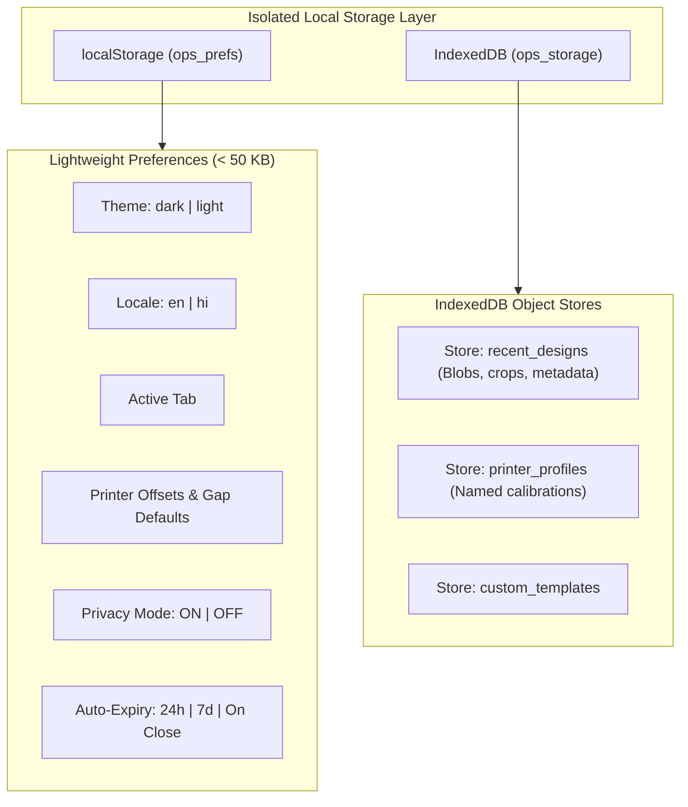

# Open Print Studio — PRD Review & Technical Audit
## Comprehensive Audit of Contradictions, Impossible Numbers, Ambiguities & Risks

**Document Version:** 1.0.0  
**Target Architecture:** Desktop Application (Electron + React 19 + TypeScript + Vite)  
**Author:** Senior Product Architect & Full-Stack Engineer  
**Status:** Pending Stakeholder Approval (Phase 0 Review)  

---

> [!IMPORTANT]
> This review establishes a rigorous, clean-room foundation for **Open Print Studio** (`OPS`), designed specifically for Indian Cyber Cafes, Common Service Centers (CSCs), and Photo Studios. Every claim is validated against physical geometry, operating system capabilities, and data privacy principles.

---

## 1. Executive Audit Summary

The initial Product Requirements Document (PRD v2.0) provided a strong domain foundation for Indian retail print shops, correctly identifying key workflows such as e-Aadhaar decryption, CR-80 PVC cards, visiting cards, membership cards, and AI passport photo sheets.

However, a deep engineering audit reveals **10 critical contradictions, impossible physical assertions, and architectural risks** that must be resolved before any code is written:

| # | Domain / Area | Severity | Core Issue | Resolution |
| :--- | :--- | :--- | :--- | :--- |
| **1** | **Sheet Capacity Math** | **Critical (Fatal)** | PRD claims 4×6 photo paper fits "2 complete card pairs" (4 sides). Physically impossible by geometry. | Correct to exactly **2 cards = 1 card pair** ($1\times\text{Front} + 1\times\text{Back}$). |
| **2** | **Photo Studio Grids** | **Critical (Fatal)** | Hardcoded grids (8-up, 12-up on 4×6; 32-up on A4) fail depending on photo dimensions. 12-up 35×45mm cannot fit on 4×6. | Replace hardcoded grids with dynamic **Mathematical Layout Solver** with rotation awareness and "Fit to Sheet". |
| **3** | **Data Persistence & Privacy** | **High (Security & Stability)** | Storing unencrypted recent card designs (with customer photos and mobile numbers) in `localStorage` hits 5MB quota and breaches DPDP customer privacy. | Segregate into `localStorage` (UI prefs) + `IndexedDB` (`ops_db`), with auto-expiry, "Clear All", and "Privacy Mode". |
| **4** | **AI Vision Pipeline** | **High (Deprecation & Offline)** | `@mediapipe/selfie_segmentation` is deprecated and defaults to cloud CDN. | Upgrade to modern `@mediapipe/tasks-vision` `ImageSegmenter` with local offline WASM and models in a Web Worker. |
| **5** | **Hardware Scanner** | **Medium (Portability)** | Hardcoded Windows-only WIA PowerShell script breaks Linux/Ubuntu CSC environments. | Define cross-platform `ScannerProvider` interface with WIA (Windows), SANE (Linux), and File Import fallback. |
| **6** | **Printer Tray Switching** | **Medium (OS Reality)** | Electron cannot programmatically switch physical printer trays via standard print API. | Model as **Saved Printer Profiles** with interactive in-app driver setup guide. |
| **7** | **Clean-Room Hygiene** | **High (Legal / Brand)** | Lingering 3rd-party keys, external URLs, and claims of accessing proprietary sources. | Clean neutral namespace `ops_` throughout. Purge all 3rd-party branding; establish genuine clean-room specification. |
| **8** | **UI Responsiveness** | **Medium (UX Performance)** | Decrypting multi-page PDFs and running AI on main thread freezes React 19 UI. | Dedicated Web Workers for PDF decryption/rendering and MediaPipe AI segmentation. |
| **9** | **Document Cleaner Risk** | **High (Legal / Integrity)** | Unchecked automated masking of official identity documents. | Strictly Opt-In disclaimer cleaner, mathematically restricted to UIDAI bottom notice zone, zero overlap with ID content. |
| **10** | **Calibration & Gaps** | **Medium (Clarity)** | Ambiguity between PVC tray gap and A4 multi-card sheet gap; lack of printer calibration workflow. | Explicit separation of `pvcHGap`/`pvcVGap` vs `sheetNormalVGap`/`sheetNormalHGap`; add interactive Calibration Wizard. |

---

## 2. In-Depth Technical Audits & Mathematical Proofs

### 2.1 Sheet Capacity: Physical Geometry Proofs

#### The ISO/IEC 7810 ID-1 Standard (CR-80)
- **Standard Width:** $85.60\,\text{mm}$ (tolerated $\pm 0.12\,\text{mm}$)
- **Standard Height:** $53.98\,\text{mm}$ (tolerated $\pm 0.05\,\text{mm}$)
- **Corner Radius:** $3.18\,\text{mm}$
- **300 DPI Conversion Factor:** $1\,\text{inch} = 25.4\,\text{mm} \implies \frac{300}{25.4} \approx 11.8110236\,\text{px/mm}$
  - Exact Width in Pixels: $85.60 \times \frac{300}{25.4} = 1011.0236 \approx 1011\,\text{px}$
  - Exact Height in Pixels: $53.98 \times \frac{300}{25.4} = 637.559 \approx 638\,\text{px}$

#### Proof 1: The 4×6 Photo Paper Capacity
- **Paper Dimensions:** $4 \times 6\,\text{inches} = 101.6 \times 152.4\,\text{mm}$ (commonly rounded to $102 \times 152\,\text{mm}$).
- **The PRD Claim:**
  - Section 4.4 states: *"4×6 Photo Paper (102×152 mm) — 2 Card Pairs (was wrong: not 1) — Side-by-side layout — 2 full cards per photo paper."*
  - Section 11 Criterion 3 states: *"Must fit exactly 2 complete card pairs (Front + Back × 2) on a 102×152mm photo paper."*
- **Mathematical Contradiction:**
  - "2 complete card pairs" equals **4 individual card sides** (Card 1 Front, Card 1 Back, Card 2 Front, Card 2 Back).
  - Can 4 CR-80 cards fit on a 4×6 sheet ($101.6 \times 152.4\,\text{mm}$)?
    - Any arrangement of 4 cards requires at least a $2 \times 2$ matrix.
    - Even with the cards rotated to minimize width (portrait orientation: width $53.98\,\text{mm}$, height $85.60\,\text{mm}$):
      $$\text{Minimum Width Required} = 2 \times 53.98\,\text{mm} = 107.96\,\text{mm}$$
      $$\text{Paper Narrow Dimension} = 101.60\,\text{mm}$$
      $$\Delta = 107.96\,\text{mm} - 101.60\,\text{mm} = +6.36\,\text{mm}\ (\text{EXCEEDS PAPER BOUNDS})$$
    - Even with **$0\,\text{mm}$ margin and $0\,\text{mm}$ gap**, two cards side by side along the narrow edge overhang the physical paper by $6.36\,\text{mm}$!
    - Along the length dimension ($152.4\,\text{mm}$):
      $$\text{Minimum Length Required} = 2 \times 85.60\,\text{mm} = 171.20\,\text{mm}$$
      $$\text{Paper Long Dimension} = 152.40\,\text{mm}$$
      $$\Delta = 171.20\,\text{mm} - 152.40\,\text{mm} = +18.80\,\text{mm}\ (\text{EXCEEDS PAPER BOUNDS})$$
- **Conclusion:** It is physically impossible to print 4 CR-80 cards (2 card pairs) at 100% scale on 4×6 photo paper.
- **Valid Physical Specification:**
  - Oriented landscape ($85.60 \times 53.98\,\text{mm}$):
    - Columns: $1$ card ($85.60\,\text{mm} \le 101.6\,\text{mm}$). Horizontal margin = $\frac{101.6 - 85.6}{2} = 8.0\,\text{mm}$.
    - Rows: $2$ cards ($53.98 \times 2 = 107.96\,\text{mm} \le 152.4\,\text{mm}$). Vertical remaining space = $152.4 - 107.96 = 44.44\,\text{mm}$.
    - Total Capacity: **Exactly 2 cards = 1 Card Pair (Front + Back)**.

#### Proof 2: The A4 Sheet Capacity
- **Paper Dimensions:** $210.0 \times 297.0\,\text{mm}$.
- **Target:** CR-80 Cards ($85.60 \times 53.98\,\text{mm}$)
  - Columns ($2$ landscape cards): $2 \times 85.60\,\text{mm} = 171.20\,\text{mm}$.
    - Remaining width: $210.0 - 171.20 = 38.80\,\text{mm}$.
    - With a center gap of $4.0\,\text{mm}$, left and right margins are $\frac{38.80 - 4.0}{2} = 17.40\,\text{mm}$ each.
  - Rows ($5$ rows): $5 \times 53.98\,\text{mm} = 269.90\,\text{mm}$.
    - Remaining height: $297.0 - 269.90 = 27.10\,\text{mm}$.
    - With 4 inter-row gaps of $2.5\,\text{mm}$ ($10.0\,\text{mm}$ total), top and bottom margins are $\frac{27.10 - 10.0}{2} = 8.55\,\text{mm}$ each.
  - Total Capacity: $2 \times 5 = 10$ cards = **5 Complete Card Pairs** (Front + Back × 5). Fully verified!

#### Proof 3: Visiting Cards on A4
- **Card Size:** $85.0 \times 55.0\,\text{mm}$.
- **Grid:** 2 columns × 5 rows on A4 ($210 \times 297\,\text{mm}$):
  - Width: $2 \times 85.0 = 170.0\,\text{mm} \le 210.0\,\text{mm}$ (margin space $40.0\,\text{mm}$).
  - Height: $5 \times 55.0 = 275.0\,\text{mm} \le 297.0\,\text{mm}$ (margin space $22.0\,\text{mm}$).
  - Total Capacity: **10 Visiting Cards per A4 sheet** with $3\,\text{mm}$ cut-guides. Fully verified!

---

### 2.2 Photo Grid Constraints & Layout Solver

#### The PRD Flaw
Section 4.5 of the PRD states fixed grid configurations:
- 4×6: 8-up (2×4) or 12-up (3×4)
- A4: 16-up (4×4) or 32-up (4×8)

#### Geometric Verification by Photo Preset
1. **Indian Passport Standard ($35.0 \times 45.0\,\text{mm}$)** on 4×6 Paper ($101.6 \times 152.4\,\text{mm}$):
   - **Portrait Orientation ($35\,\text{W} \times 45\,\text{H}$):**
     - $\lfloor 101.6 / 35.0 \rfloor = 2$ columns ($70.0\,\text{mm}$).
     - $\lfloor 152.4 / 45.0 \rfloor = 3$ rows ($135.0\,\text{mm}$).
     - Max count = $2 \times 3 = 6$ photos. **(NOT 8!)**
   - **Rotated Orientation ($45\,\text{W} \times 35\,\text{H}$):**
     - Width: $2 \times 45.0 = 90.0\,\text{mm} \le 101.6\,\text{mm}$ (margin $11.6\,\text{mm}$).
     - Height: $4 \times 35.0 = 140.0\,\text{mm} \le 152.4\,\text{mm}$ (margin $12.4\,\text{mm}$).
     - With $2\,\text{mm}$ gaps: Width = $92.0\,\text{mm}$, Height = $140 + 6 = 146.0\,\text{mm} \le 152.4\,\text{mm}$.
     - Max count = $2 \times 4 = \mathbf{8\ \text{photos}}$.
     - **Discovery:** 8-up on 4×6 is geometrically valid **ONLY when the 35×45mm photos are rotated by 90°**!
   - **Can 12-up ($3 \times 4$) fit 35×45mm photos on 4×6?**
     - Portrait 3 cols: $3 \times 35.0 = 105.0\,\text{mm} > 101.6\,\text{mm}$ (exceeds paper by $3.4\,\text{mm}$).
     - Rotated 3 cols: $3 \times 45.0 = 135.0\,\text{mm} > 101.6\,\text{mm}$ (exceeds paper by $33.4\,\text{mm}$).
     - **Conclusion:** 12-up is physically impossible for standard passport photos on 4×6.
2. **Stamp Size ($25.0 \times 30.0\,\text{mm}$)** on 4×6 Paper:
   - 3 columns × 4 rows: Width $3 \times 25.0 = 75.0\,\text{mm} \le 101.6\,\text{mm}$; Height $4 \times 30.0 = 120.0\,\text{mm} \le 152.4\,\text{mm}$.
   - Max count = $\mathbf{12\ \text{photos}}$. Fits easily!
3. **A4 Paper ($210 \times 297\,\text{mm}$)** for 35×45mm Passport:
   - Can 32-up ($4 \times 8$) fit portrait 35×45mm?
     - 8 rows of $45\,\text{mm} = 360.0\,\text{mm} > 297.0\,\text{mm}$! Exceeds paper by $63.0\,\text{mm}$!
   - Can 32-up fit rotated 45×35mm?
     - 4 cols of $45\,\text{mm} = 180.0\,\text{mm} \le 210.0\,\text{mm}$.
     - 8 rows of $35\,\text{mm} = 280.0\,\text{mm} \le 297.0\,\text{mm}$.
     - Remaining vertical space = $17.0\,\text{mm}$.
     - With 7 inter-row gaps of $1.5\,\text{mm}$ ($10.5\,\text{mm}$), top/bottom margin is $3.25\,\text{mm}$ each.
     - Valid, but requires rotation and tight margins!
   - Stamp size ($25 \times 30\,\text{mm}$) on A4 fits 32-up ($4 \times 8$) comfortably.

#### Proposed Solution: Pure TS Layout Solver
Instead of brittle hardcoded preset menus, we implement a pure, deterministic `LayoutSolver` engine:

```typescript
export interface LayoutSolverInput {
  paperWidthMm: number;
  paperHeightMm: number;
  itemWidthMm: number;
  itemHeightMm: number;
  horizontalGapMm: number;
  verticalGapMm: number;
  marginMm: { top: number; right: number; bottom: number; left: number };
  allowRotation: boolean;
}

export interface LayoutSlot {
  xMm: number;
  yMm: number;
  widthMm: number;
  heightMm: number;
  isRotated: boolean;
  colIndex: number;
  rowIndex: number;
}

export interface LayoutSolverResult {
  cols: number;
  rows: number;
  totalCapacity: number;
  isRotated: boolean;
  actualMarginMm: { top: number; right: number; bottom: number; left: number };
  slots: LayoutSlot[];
  isValid: boolean;
  warningMessage?: string;
}
```

The solver calculates both normal and rotated fits, validates minimum margins, and provides an automatic **"Fit to Sheet"** mode alongside custom overrides.

---

### 2.3 Persistence Architecture & Customer Data Privacy

#### The PRD Risk
The PRD specifies persisting recent designs (containing document crops, base64 thumbnails, and customer mobile numbers) directly into `localStorage`.
1. **Quota Crash:** In Chromium, `localStorage` is capped at $5\,\text{MB}$ synchronous UTF-16 storage. Storing 10 high-resolution cropped ID card bitmaps easily exceeds this quota, causing immediate `QuotaExceededError` crashes in production.
2. **Main Thread Blocking:** Serializing and deserializing megabytes of JSON stringified bitmaps blocks the JavaScript main thread, causing UI freezes.
3. **Data Privacy & Compliance (DPDP Act 2023):** Cyber cafes handle sensitive government IDs (Aadhaar, PAN, Ayushman). Storing customer identity documents and phone numbers indefinitely on a shared shop PC creates grave legal liability and leak risks.

#### Proposed Storage Architecture


#### Privacy Controls:
- **Privacy Mode Toggle ("Don't Save History"):** When enabled, no session or customer ID data is written to disk; everything is kept in volatile RAM and cleared on document close or app exit.
- **Auto-Expiry Engine:** Background lifecycle check removes sessions older than the user-configured window (default: 24 hours).
- **"Clear All History" Action:** One-click instant wipe of all cached ID crops, mobile numbers, and thumbnails in IndexedDB.
- **Export / Import Settings:** Only exports calibration profiles and layout preferences; never exports customer ID records.

---

### 2.4 Modern Offline AI Pipeline

#### The PRD Risk
PRD references `@mediapipe/selfie_segmentation`.
- This package is **deprecated** by Google.
- Its legacy loader attempts to fetch WASM/binary models from Google's CDN (`cdn.jsdelivr.net`) at runtime if not strictly monkey-patched, violating our **100% offline-first** mandate.

#### Proposed Implementation
- Use `@mediapipe/tasks-vision` modern API (`ImageSegmenter`).
- Bundle the model `selfie_segmenter.tflite` (or `selfie_multiclass_256x256.tflite`) directly in `public/models/`.
- Bundle `@mediapipe/tasks-vision/wasm` binaries directly in `public/wasm/`.
- Offload segmentation to a dedicated **Web Worker** (`segmenter.worker.ts`) using `OffscreenCanvas` and transferrable `ImageBitmap` so the React 19 UI runs at a continuous 60 FPS without jitter.

---

### 2.5 Scanner Abstraction: Cross-Platform Support

#### The PRD Flaw
The PRD assumes WIA via PowerShell scripts (`WIA PowerShell`). This fails completely on Linux systems (such as Ubuntu or BOSS Linux, which are actively deployed in many government CSC centers).

#### Proposed Architecture: `ScannerProvider`
We define a clean provider interface:

```typescript
export interface ScannerDevice {
  id: string;
  name: string;
  type: "flatbed" | "feeder";
}

export interface ScanOptions {
  deviceId: string;
  resolutionDpi: 150 | 300 | 600;
  colorMode: "color" | "grayscale" | "bw";
}

export interface ScannerProvider {
  isAvailable(): Promise<boolean>;
  listDevices(): Promise<ScannerDevice[]>;
  scan(options: ScanOptions): Promise<Blob>;
}
```

1. **`WiaScannerProvider` (Windows):** Interfaces with Windows Image Acquisition (WIA) via native PowerShell or lightweight native helper.
2. **`SaneScannerProvider` (Linux):** Interfaces with SANE (`scanimage`) utility via IPC.
3. **`FileImportScannerProvider` (Universal Fallback):** When no hardware scanner driver is detected, provides an instant drag-and-drop or system file dialog scanner import.

---

### 2.6 Printer Tray Switching vs Driver Profiles

#### Technical Reality
Chromium and Electron print APIs (`webContents.print({ ... })`) pass parameters down to the OS spooler. Neither Windows GDI nor Linux CUPS exposes vendor-specific mechanical tray switching (e.g. Epson's proprietary "CD/DVD Tray" or Canon's "Manual Feed Slot") through standard Web print dialog options.

#### Proposed Solution
1. **Saved Printer Profiles:**
   - Allow shopkeepers to save named presets: e.g., *"Epson L805 - PVC Card Tray"*, *"Epson L805 - 4x6 Photo Paper"*, *"Canon G3010 - A4 Regular"*.
   - Each profile saves exact page dimensions, calibration offsets ($X, Y$), card scale ($1.0$), and target margins ($0\,\text{mm}$).
2. **In-App Driver Setup Guide:**
   - A step-by-step visual modal showing shopkeepers how to configure their Windows printer driver settings once (selecting "CD/DVD Tray" or "Borderless Photo") and saving it as a Windows printing preset.

---

### 2.7 Clean-Room Namespace & Brand Neutrality

To eliminate intellectual property exposure and enforce a professional clean-room standard:
1. **Namespace Standard:**
   - All storage keys, internal events, and custom file formats will use the neutral prefix `ops_` (Open Print Studio).
   - Examples: `ops_prefs`, `ops_recents`, `ops_printer_profiles`, `ops_calibration`.
2. **Documentation Purge:**
   - Completely remove all 3rd-party product names, external server URLs, and terms like proprietary deobfuscation from all code, comments, commits, and user documentation.
   - All specifications are documented strictly from ISO standards, public government ID dimensions, and vendor printer specifications.

---

### 2.8 Faint Text Darkening & Aadhaar Disclaimer Patching

#### Text Boldness / Contrast Engine (`textBoldLevel` 0–5)
Faded government printouts often suffer from low ink density.
- We implement an analytical S-curve luminance transfer function:
  $$L_{\text{out}} = \frac{1}{1 + e^{-k(L_{\text{in}} - L_0)}}$$
  where $k$ is controlled by `textBoldLevel` (0 = linear passthrough, 5 = steep thresholding), boosting low-contrast black ink while preserving white background clarity.

#### Aadhaar Disclaimer Cleaner
- **Privacy & Legal Safeguard:** This feature is strictly **Opt-In** (default OFF).
- **Region Restriction:** The mask applies only to the standard UIDAI boilerplate disclaimer region located at the bottom of the card:
  - Coordinate box: Relative $Y \in [0.91, 0.99]$, Relative $X \in [0.05, 0.95]$.
  - The engine enforces a hard bounding box clamp that is physically prohibited from overlapping the photo, QR code, name, DOB, gender, or Aadhaar number zones.

---

## 3. Comparative Summary: PRD Claim vs Physical Reality

| Feature / Metric | PRD v2.0 Claim | Verified Physical Reality | Proposed Open Print Studio Spec |
| :--- | :--- | :--- | :--- |
| **4×6 ID Card Capacity** | 2 Card Pairs (4 sides) | 4 cards need $108\times171\,\text{mm}$; paper is $102\times152\,\text{mm}$. Cannot fit! | **1 Card Pair (2 sides = 1 Front + 1 Back)** at 100% scale. |
| **A4 ID Card Capacity** | 5 Card Pairs (10 sides) | $2 \times 5$ cards need $171.2 \times 269.9\,\text{mm}$; A4 is $210 \times 297\,\text{mm}$. | **5 Card Pairs (10 sides)** with cut marks and $17\,\text{mm}$ margins. |
| **Visiting Card A4** | 10-up (2×5) | $2 \times 5$ cards need $170 \times 275\,\text{mm}$; A4 is $210 \times 297\,\text{mm}$. | **10 Cards per A4** with $3\,\text{mm}$ cut guides. |
| **4×6 Passport Grid** | Fixed 8-up and 12-up | 8-up only fits if $35\times45\,\text{mm}$ is rotated; 12-up only fits $25\times30\,\text{mm}$ stamp. | **Dynamic Layout Solver** with rotation awareness & fit warning. |
| **Recent Designs Storage** | `localStorage` (raw customer sessions) | 5MB quota crash with base64; security risk for customer IDs. | **IndexedDB (`ops_db`)** with auto-expiry, wipe, and privacy mode. |
| **AI Segmentation** | `@mediapipe/selfie_segmentation` | Legacy/deprecated package; risks network calls. | **`@mediapipe/tasks-vision`** in Web Worker, 100% offline bundled assets. |
| **Scanner Bridge** | Windows WIA PowerShell only | Incompatible with Linux/BOSS CSC setups. | Cross-platform **`ScannerProvider`** (WIA, SANE, File Import). |
| **Hardware Tray Switch** | Programmatic tray command | Chromium print API cannot trigger mechanical tray changes. | **Saved Printer Profiles** + In-app Driver Configuration Wizard. |
| **Naming & Clean-Room** | 3rd-party keys & proprietary references | Contaminated namespace and legal risk. | Neutral **`ops_*` namespace**; 100% clean-room specification. |
| **Disclaimers Cleaner** | Active by default in diagrams | Potential document alteration risk. | **Opt-In (Default OFF)** with strictly bounded non-essential region mask. |

---

## 4. Architectural Decisions & Next Steps

Upon approval of this review, we will execute the **Implementation Plan** adhering to these verified specifications:
1. Pure TypeScript geometry and layout solver package (`@ops/core`).
2. Dual Web Worker architecture (PDF decryption and AI vision).
3. Zero-telemetry offline Electron shell with strict CSP.
4. Comprehensive test suite with golden mm coordinate validation.
