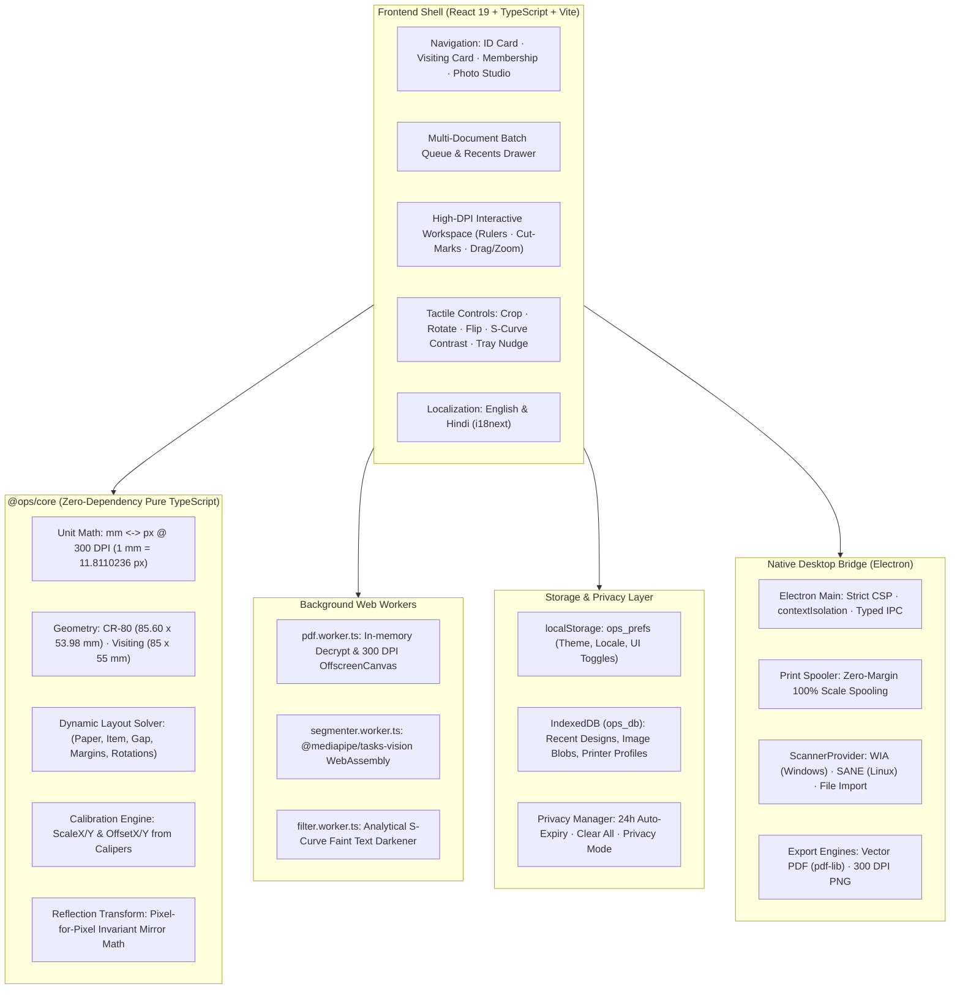

# Project Requirements Document (PRD v3.0 — Authoritative Clean-Room Specification)
## Open Print Studio (`ops`) — Offline-First Card & Photo Printing System

---

> [!IMPORTANT]
> **Authoritative Specification:** This document supersedes all prior drafts and reflects mathematically verified physical sheet capacities, genuine clean-room implementation (`ops_` namespace), strict DPDP data privacy standards, modern offline AI vision architecture, and production desktop engineering standards.

---

## 1. Executive Summary & Objective

**Open Print Studio** is an offline-first desktop application engineered specifically for **Indian Cyber Cafes, Common Service Centers (CSCs), Photostat/Xerox Shops, and Photo Studios**.

### 1.1 Problem Statement
Retail print shops in India process hundreds of government identity documents (e-Aadhaar, Ayushman Bharat, PAN, Voter ID, e-Shram), visiting cards, and passport photo sheets daily. Existing commercial tools suffer from:
- Fragile cloud license servers, mandatory online pings, and hardware lock-ins.
- Freezing UI threads during PDF decryption and AI background removal.
- Severe paper misalignments and scaling distortion due to default browser print margins.
- Storage of customer identity documents and phone numbers in unencrypted browser storage without auto-expiry or privacy controls.
- English-only interfaces with tiny, mouse-dependent controls ill-suited for noisy retail counters.

### 1.2 Core Product Pillars
1. **100% Offline-First:** Runs completely offline with zero telemetry, zero analytics pings, and zero remote API dependencies.
2. **Mathematical Precision at 300 DPI:** Every sheet capacity, card boundary, and nudge offset is computed from ISO physical dimensions and DPI constants—never guessed or asserted.
3. **Dedicated Worker Threads:** Heavy PDF decryption/rasterization and AI segmentation execute inside background Web Workers, keeping the React 19 UI running at a fluid 60 FPS.
4. **Data Privacy & DPDP Compliance:** Customer identity documents and mobile numbers are stored in IndexedDB with auto-expiry (24h default), instant wipe, and a "Privacy Mode" toggle.
5. **Ergonomic Shopkeeper UX:** Batch queues, drag-and-drop, keyboard shortcuts, live millimeter rulers, tactile touch-friendly controls, and full English + Hindi (हिन्दी) bilingual support.

---

## 2. Clean-Room Provenance & Compliance

- **Untainted Clean-Room Design:** Completely independent specification authored from public standards (ISO/IEC 7810 ID-1, W3C standards) and original UI architecture.
- **Zero Third-Party Product References:** Strictly bans third-party branding, proprietary identifiers, and remote URLs across all code, comments, tests, and documentation.
- **Neutral Namespace:** All storage keys, IndexedDB databases, and IPC channels strictly utilize the `ops_` / `ops:*` neutral prefix.
- **Permissive Open-Source Licensing:** All runtime dependencies utilize permissive commercial open-source licenses (MIT, Apache-2.0, BSD).

---

## 3. High-Level System Architecture



---

## 4. Detailed Module Specifications

### Module 1: ID Card & PVC Printing Engine

#### 1.1 Ingestion & In-Memory Decryption
- **File Ingestion:** Drag-and-drop or file dialog for `.pdf`, `.png`, `.jpg`, `.jpeg`, `.webp`.
- **Password Decryption:** For password-protected e-Aadhaar PDFs (`FIRST 4 LETTERS OF NAME CAPS + BIRTH YEAR`, e.g., `RAMA1985`):
  - Decrypted strictly in volatile memory inside `pdf.worker.ts` via `pdfjs-dist` v4.
  - Password strings are never logged, cached in localStorage, or committed to disk.

#### 1.2 Automated Crop Templates & CR-80 Normalization
- All templates stored as pure JSON data in `crop-templates.json`:
  - **e-Aadhaar (UIDAI Standard):** Auto relative crops: Front `[0.05, 0.68, 0.42, 0.28]`, Back `[0.53, 0.68, 0.42, 0.28]`.
  - **Ayushman Bharat (PM-JAY):** Dual 50/50 vertical split with 90° rotation.
  - **PAN Card (NSDL/UTIITSL):** Single front bounding box locked to ID-1 ratio.
  - **Voter ID (e-EPIC):** Standard dual card crop.
  - **e-Shram:** Standard dual card crop.
  - **Custom / Scanned:** Interactive dual-crop handles with free pan/zoom and aspect-ratio locking.
- **CR-80 Normalization:** Every crop normalizes to standard ISO/IEC 7810 ID-1 ($85.60 \times 53.98\,\text{mm} \implies 1011 \times 638\,\text{px at 300 DPI}$).
- **Independent Rotation:** Each side supports independent 0°, 90°, 180°, 270° orientation.

#### 1.3 Practical Enhancements for Retail Operators
1. **Faint Text Darkener (`textBoldLevel` 0–5):**
   - Applies an analytical S-curve luminance filter $L_{\text{out}} = \frac{255}{1 + e^{-k \cdot (L_{\text{in}} - 128) / 32}}$ to darken low-ink government text while preserving white backgrounds ($L > 220$).
2. **Aadhaar Disclaimer Cleaner (`activePdfPatches`):**
   - **Strictly Opt-In:** Disabled by default.
   - Constrained to UIDAI bottom boilerplate zone ($Y \in [0.92, 0.985], X \in [0.05, 0.95]$).
   - Enforces a hard exclusion zone: mathematically prohibited from intersecting photo, QR code, name, or Aadhaar number pixels.
3. **Signature & Official Stamp Overlay (`stampSettings`):**
   - Composite official seals, signatures, or thumb impressions directly onto card bitmaps with position, scale, rotation, and B&W threshold controls.
4. **Customer Mobile Number on Card (`mobileNumberConfig`):**
   - Overlays the customer's phone number onto front or back card corners for shop identification. Distinct from shop branding.
5. **Shop Tagline Branding (`shopTagline`):**
   - Rendered on the A4/4×6 paper margins, completely outside card cut-boundaries.

---

### Module 2: Visiting Card Printing Engine
- **Standard Dimensions:** $85.0 \times 55.0\,\text{mm}$ ($1004 \times 650\,\text{px at 300 DPI}$).
- **A4 10-Up Sheet Layout:** 2 columns × 5 rows on A4 ($210 \times 297\,\text{mm}$):
  - Width: $2 \times 85.0 = 170.0\,\text{mm} \le 210\,\text{mm}$ (margin space $40.0\,\text{mm}$).
  - Height: $5 \times 55.0 = 275.0\,\text{mm} \le 297\,\text{mm}$ (margin space $22.0\,\text{mm}$).
  - Cut Guides: Standard $3\,\text{mm}$ vector crop guides between cards.
- **Media Finish Presets:** Quick selection for Glossy, Matte, and Heavy Inkjet paper profiles.

---

### Module 3: Membership Card Printing Engine
- **Target Audience:** Gyms, societies, libraries, clubs, and educational institutions.
- **Dimensions:** Standard CR-80 ($85.60 \times 53.98\,\text{mm}$).
- **Template Mode:** Accepts pre-designed card graphics (front and back); bypasses government document crop splitters.
- **Supported Layouts:** A4 5-Card, 4×6 1-Card Pair, and Dedicated PVC Trays.

---

### Module 4: AI Passport Photo Studio

#### 4.1 Modern Offline AI Segmentation
- **Engine:** `@mediapipe/tasks-vision` `ImageSegmenter` (WebAssembly + WebGL).
- **Offline Assets:** Bundled `selfie_segmenter.tflite` ($< 1\,\text{MB}$) and WASM runtimes; zero runtime CDN calls.
- **Edge Feathering:** 1.5px Gaussian kernel smoothing on alpha mask to eliminate blue fringe and provide natural hair edge blending.
- **Performance Budget:** End-to-end execution $< 1.5\,\text{seconds}$ on dual-core retail laptops.
- **Low-Resolution Warning:** Automatically displays non-blocking warning if portrait input is $< 600\,\text{px}$.

#### 4.2 Photo Enhancements & Color Presets
- **Image Adjustments:** Brightness ($-100$ to $+100$), Saturation ($-100$ to $+100$), Sharpness ($0$ to $100$).
- **Background Fills:** Studio Blue (`#2B6CB0`), Studio White (`#FFFFFF`), Off-White/Grey (`#E2E8F0`), Custom Color Picker.

#### 4.3 Dimension Presets & Layout Solver
- **Size Presets:**
  - Indian Passport / Government Standard: $35.0 \times 45.0\,\text{mm}$
  - Indian Stamp Size: $25.0 \times 30.0\,\text{mm}$
  - International / US Visa: $50.8 \times 50.8\,\text{mm}$ ($2 \times 2$ inches)
  - Custom Size: User-defined width and height in millimeters.
- **Dynamic Layout Solver:**
  - Calculates maximum capacity based on item dimensions, sheet size, margins, and gaps.
  - Automatically evaluates both portrait and 90° rotated item orientations.
  - **Mathematical Capacities:**
    - 4×6 ($101.6 \times 152.4\,\text{mm}$): Fits **8 Passport Photos (2×4)** only when rotated $45 \times 35\,\text{mm}$. Fits **12 Stamp Photos (3×4)** unrotated.
    - A4 ($210 \times 297\,\text{mm}$): Fits **16 Passport Photos (4×4)** with generous margins; fits **32 Stamp Photos (4×8)**.

---

### Module 5: Sheet Capacity, Layout Solver & Calibration

#### 5.1 Verified Mathematical Sheet Capacities

| Media | Dimensions (mm) | Target Item | Columns × Rows | Total Capacity | Mathematical Clearance & Margins |
| :--- | :--- | :--- | :--- | :--- | :--- |
| **A4 Paper** | $210.0 \times 297.0$ | CR-80 Card ($85.60 \times 53.98$) | $2 \times 5$ | **10 Cards (5 Pairs)** | Width: $171.2\,\text{mm}$ (rem: $38.8\,\text{mm}$). Height: $269.9\,\text{mm}$ (rem: $27.1\,\text{mm}$). |
| **4×6 Photo** | $101.6 \times 152.4$ | CR-80 Card ($85.60 \times 53.98$) | $1 \times 2$ | **2 Cards (1 Pair)** | Width: $85.6\,\text{mm}$ (rem: $16.0\,\text{mm}$). Height: $108.0\,\text{mm}$ (rem: $44.4\,\text{mm}$). **2 Pairs Impossible.** |
| **PVC Tray** | Dedicated Tray | CR-80 Card ($85.60 \times 53.98$) | $1 \times 2$ | **2 Cards (1 Pair)** | Exact tray slot cutouts for Epson/Canon card trays. |
| **A4 Paper** | $210.0 \times 297.0$ | Visiting Card ($85.0 \times 55.0$) | $2 \times 5$ | **10 Cards** | Width: $170.0\,\text{mm}$ (rem: $40.0\,\text{mm}$). Height: $275.0\,\text{mm}$ (rem: $22.0\,\text{mm}$). |
| **4×6 Photo** | $101.6 \times 152.4$ | Passport ($35.0 \times 45.0$ rotated) | $2 \times 4$ | **8 Photos** | Width: $90.0\,\text{mm}$ (rem: $11.6\,\text{mm}$). Height: $140.0\,\text{mm}$ (rem: $12.4\,\text{mm}$). |
| **4×6 Photo** | $101.6 \times 152.4$ | Stamp ($25.0 \times 30.0$) | $3 \times 4$ | **12 Photos** | Width: $75.0\,\text{mm}$ (rem: $26.6\,\text{mm}$). Height: $120.0\,\text{mm}$ (rem: $32.4\,\text{mm}$). |

#### 5.2 Tray Nudge & Calibration Parameters
- `pvcHGap` / `pvcVGap`: Physical spacing between cards on dual PVC plastic trays.
- `sheetNormalVGap` / `sheetNormalHGap`: Grid spacing between card rows/columns on multi-card A4 and 4×6 sheets.
- `offsetX` / `offsetY`: Global print origin shift in millimeters.
- `cardScale`: Global card scale multiplier (nominal: `1.000`).
- `isFlipped`: Horizontally mirrors the entire sheet bitmap for reverse/thermal PVC printers.
  - Mathematical Invariance: $X' = W_{\text{sheet}} - X - W_{\text{item}}$. Applying twice reproduces the original image pixel-for-pixel.

#### 5.3 Printer Calibration Wizard
1. Operator prints a standardized test sheet with precision $100\,\text{mm}$ reference rulers on the $X$ and $Y$ axes.
2. Operator measures actual printed lines with a digital caliper or metric ruler.
3. System derives exact correction factors:
   $$\text{scaleX} = \frac{100.00}{L_{X,\text{measured}}},\quad \text{scaleY} = \frac{100.00}{L_{Y,\text{measured}}}$$
   $$\text{offsetX} = X_{\text{target}} - X_{\text{measured}},\quad \text{offsetY} = Y_{\text{target}} - Y_{\text{measured}}$$
4. Profile is saved in IndexedDB under `printer_profiles` to guarantee $\pm 0.4\,\text{mm}$ accuracy.

---

### Module 6: Hardware Bridge & Print Pipeline

#### 6.1 Zero-Margin Print Spooling
- Electron's `webContents.print()` is executed with:
  ```typescript
  {
    silent: false,
    printBackground: true,
    margins: { marginType: "none" },
    pageSize: profile.pageSize,
    landscape: profile.orientation === "landscape",
    scaleFactor: 100
  }
  ```
- **Driver Tray Reality:** Chromium cannot programmatically switch physical printer trays. Handled via **Saved Printer Profiles** (e.g., "Epson L805 - PVC Tray") paired with a one-time in-app visual driver setup guide.
- **Offline Printer Handling:** Detects offline or disconnected printers using `getPrintersAsync()` and displays friendly actionable alerts.

#### 6.2 Export Engines
- **Archival PDF Export (`pdf-lib`):** Generates vector print-ready PDFs with embedded 300 DPI PNG cards and vector cut marks.
- **High-Res PNG Export:** Generates uncompressed 300 DPI PNG images for external photo lab printers.

#### 6.3 Cross-Platform Scanner Bridge (`ScannerProvider`)
- Polymorphic scanner interface supporting:
  - `WiaScannerProvider`: Windows Image Acquisition via PowerShell / native helper.
  - `SaneScannerProvider`: Linux scanning via `scanimage` utility.
  - `FileImportScannerProvider`: Cross-platform fallback for drag-and-drop or manual file selection.

---

### Module 7: Data Layer & Customer Privacy

#### 7.1 Storage Segregation
- **`localStorage` (`ops_prefs`):** Strictly for lightweight application preferences ($< 50\,\text{KB}$): theme, locale, active tab, privacy toggle, auto-expiry setting.
- **`IndexedDB` (`ops_db`):**
  - Store `recent_designs`: Customer card crops, thumbnails (Blobs), layout metadata, and mobile numbers.
  - Store `printer_profiles`: Calibrated printer presets.

#### 7.2 Customer Privacy Controls (DPDP Act 2023)
- **"Don't Save History" (Privacy Mode):** All session data held strictly in RAM and garbage-collected on document close; zero writes to disk.
- **Auto-Expiry Cleanup:** Automated background job purges recent design records older than the configured threshold (default: 24 hours).
- **Instant "Clear All History":** One-click red action button in the Recents panel completely purges all cached customer documents and Blobs.

---

### Module 8: Shopkeeper Retail UX & Bilingual Support

- **Tactile High-Contrast UI:** Large touch targets (minimum $44\,\text{px}$, primary actions $52\,\text{px}$) designed for touchscreens and noisy shop counters.
- **Shortcuts:** `Ctrl+P` (Print), `Ctrl+O` (Open), `Ctrl+Z` (Undo), `Ctrl+Y` (Redo), `F` (Flip/Mirror), Arrow keys (0.1 mm nudge), `1-4` (Tab switch).
- **Live Canvas Preview:** Real millimeter tick marks along canvas borders with vector cut guides and alignment crosshairs.
- **Plain-Language Actionable Errors:** Clear error explanations with next-step recovery actions.
- **Bilingual i18n from Day One:** Instant hot-switching between English and Hindi (हिन्दी) with Devanagari typography expansion rules and offline Noto Sans fonts.

---

## 5. Complete Data Model & TypeScript Interfaces

```typescript
// === ISO Standard Constants ===
export interface CardDimensions {
  readonly widthMm: 85.60;
  readonly heightMm: 53.98;
  readonly cornerRadiusMm: 3.18;
}

// === Crop Boundaries ===
export interface CropRect {
  x: number;
  y: number;
  w: number;
  h: number;
}

export interface DocumentCropConfig {
  front: CropRect;
  back: CropRect | null;
  frontRotation: 0 | 90 | 180 | 270;
  backRotation: 0 | 90 | 180 | 270;
}

// === Overlays & Enhancements ===
export interface StampSettings {
  signImgData: string | null;
  posX: number;
  posY: number;
  scale: number;
  rotation: number;
  inkDarkness: number; // 0-100
  isBW: boolean;
}

export interface MobileNumberConfig {
  enabled: boolean;
  side: "front" | "back";
  relX: number;
  relY: number;
  rotation: number;
  color: string;
}

export interface CardEnhancementSettings {
  textBoldLevel: number; // 0-5
  activePdfPatches: string[]; // ["aadhaar_disclaimer"]
  stampSettings?: StampSettings;
  mobileNumberConfig?: MobileNumberConfig;
}

// === Photo Studio ===
export interface PhotoAdjustments {
  brightness: number; // -100 to +100
  saturation: number; // -100 to +100
  sharpness: number;  // 0 to 100
}

// === Dynamic Layout Configuration ===
export interface LayoutSlot {
  index: number;
  side: "front" | "back";
  xMm: number;
  yMm: number;
  widthMm: number;
  heightMm: number;
  isRotated: boolean;
}

export interface SheetLayoutConfig {
  id: string;
  name: string;
  paperWidthMm: number;
  paperHeightMm: number;
  orientation: "portrait" | "landscape";
  slots: LayoutSlot[];
  marginsMm: { top: number; right: number; bottom: number; left: number };
  nudge: {
    pvcHGap: number;
    pvcVGap: number;
    sheetNormalVGap: number;
    sheetNormalHGap: number;
    offsetX: number;
    offsetY: number;
    cardScale: number;
    isFlipped: boolean;
  };
  cardGapMm: number;
  showCutGuides: boolean;
  shopTagline?: string;
  showTagline: boolean;
}

// === Persistence (IndexedDB) ===
export interface RecentDesignRecord {
  id: string;
  timestamp: number;
  presetName: string;
  serviceType: "id_card" | "visiting_card" | "membership_card" | "photo_studio";
  layoutId: string;
  printerProfileId?: string;
  crops: DocumentCropConfig;
  enhancements: CardEnhancementSettings;
  customerMobile?: string;
  thumbnailBlob: Blob;
}

export interface PrinterProfileRecord {
  id: string;
  name: string;
  systemPrinterName: string;
  pageSize: "A4" | "4x6" | { width: number; height: number };
  orientation: "portrait" | "landscape";
  scaleX: number;
  scaleY: number;
  offsetX: number;
  offsetY: number;
  pvcHGap: number;
  pvcVGap: number;
  isFlipped: boolean;
  updatedAt: number;
}
```

---

## 6. Technology Stack

| Layer | Component | Specification |
| :--- | :--- | :--- |
| **Frontend Framework** | React 19 + TypeScript + Vite | Strict types, modern hooks, zero runtime styling overhead. |
| **Styling & Tokens** | Vanilla CSS + Design Tokens | Curated dark/light themes, high contrast, tactile Cyber Cafe buttons. |
| **Core Geometry Engine** | `@ops/core` | Zero-dependency pure TypeScript package. 100% testable in Vitest. |
| **PDF Processing** | `pdfjs-dist` v4 | In-memory decryption and 300 DPI OffscreenCanvas rasterization in Web Worker. |
| **AI Segmentation** | `@mediapipe/tasks-vision` | Offline WebAssembly `ImageSegmenter` running in Web Worker. |
| **State Management** | Zustand + Middleware | Typed store with undo/redo state preservation. |
| **Persistence** | `localStorage` + `IndexedDB` | `ops_prefs` for UI prefs; `ops_db` for customer designs and blobs. |
| **Desktop Shell** | Electron | Strict CSP, `contextIsolation: true`, typed preload IPC bridge. |
| **Vector PDF Export** | `pdf-lib` | Archival-grade PDF export with embedded 300 DPI PNG cards. |
| **Testing Pyramid** | Vitest + Playwright | Unit tests for math/invariance; Playwright E2E for full application flows. |

---

## 7. Build Milestones (Phases 1 to 8)

1. **Phase 1: Foundation:** Monorepo/project structure, Electron + React 19 + TypeScript + Vite, pure `@ops/core` package, settings schema with migrations, i18n (EN/HI), design system tokens.
2. **Phase 2: ID Card Engine:** PDF worker decrypt/render, crop templates, CR-80 normalizer, S-curve text darkener, opt-in disclaimer cleaner.
3. **Phase 3: Sheets & Printing:** Layout solver, A4 (5 pairs), 4×6 (1 pair), PVC tray, nudge math, flip/mirror reflection, cut marks, Electron print pipeline, PDF/PNG export.
4. **Phase 4: Overlays & Recents:** Stamp/signature overlays, customer mobile number on card, IndexedDB `recent_designs`, 24h auto-expiry, Privacy Mode.
5. **Phase 5: Visiting & Membership Cards:** A4 10-up visiting card layout (85×55 mm) with media finish presets; CR-80 membership card template mode.
6. **Phase 6: AI Passport Photo Studio:** Offline `@mediapipe/tasks-vision` worker, 1.5px feathered alpha mask, color backgrounds, brightness/saturation/sharpness, dynamic grid solver.
7. **Phase 7: Calibration & Ergonomics:** Caliper calibration wizard with ruler sheet generator, multi-file batch queue, undo/redo, shortcuts, `ScannerProvider` bridge.
8. **Phase 8: Production Hardening & Release:** Strict CSP, offline network-blocking tests, zero telemetry verification, performance benchmarks, Windows NSIS/portable packaging, operator documentation.

---

## 8. Acceptance Criteria & Quality Gates

1. **Physical Accuracy:** Printed CR-80 cards measure $85.60 \pm 0.40\,\text{mm}$ verified via caliper calibration.
2. **Computed Capacities:** All multi-up layouts match mathematical geometric limits (A4 fits 10 cards; 4×6 fits 2 cards).
3. **Zero UI Blocking:** PDF decryption and AI segmentation execute without dropping frames on the main React thread.
4. **Flip Invariance:** Mirrored output is mathematically and visually pixel-identical when inverted.
5. **Privacy Compliance:** No customer data persists in Privacy Mode; auto-expiry purges stale sessions; zero telemetry packets emitted.
6. **Clean-Room Verification:** Automated scan returns 0 violations against banned terms list.
